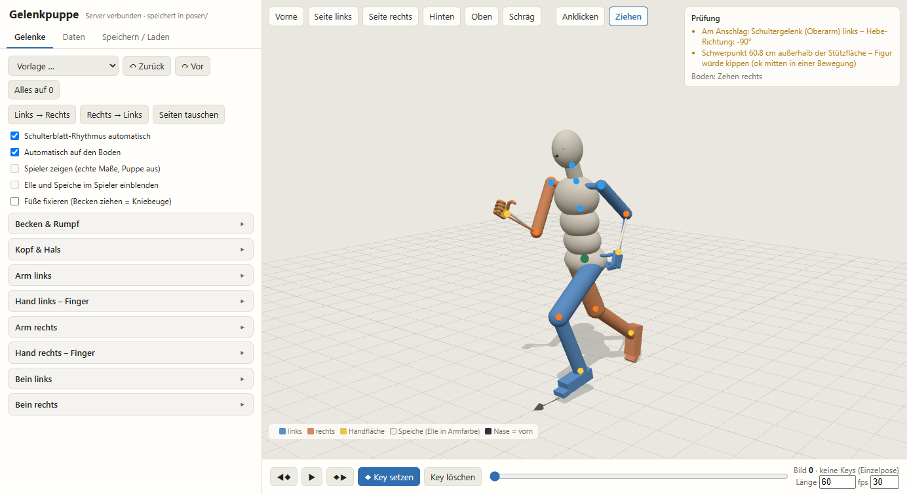

# Gelenkpuppe – Joint Puppet

**[English guide → README.md](README.md)**

Eine Posier- und Animationspuppe im Browser, gebaut nach menschlicher Anatomie. Jedes Gelenk hat seine echten
Freiheitsgrade und Bewegungsumfänge, und das Schulterblatt geht automatisch mit. Eine Prüfung meldet Haltungen, die ein
Mensch nicht schafft. Posen und Bewegungen werden als JSON gespeichert: mit Gelenkwinkeln und abgeleiteten Daten
(Gelenkpositionen, Quaternionen, Schwerpunkt, Bodenkontakt), bereit für Blender, Unity oder jede andere Engine.



## Funktionen

- **Anatomische Gelenke**: Wirbelsäule in drei Abschnitten, Hals, Kopf, Schlüsselbein/Schulterblatt, Schultergelenk
  (Hebe-Ebene, Hebung, Längsdrehung), Ellbogen mit Drehung der Speiche um die Elle (Pronation/Supination), Handgelenk,
  je Finger drei Glieder, Daumen mit Opposition, Hüfte, Knie (Drehung nur gebeugt), Sprunggelenk, Zehen. Die Grenzen
  stammen aus Normtabellen für Bewegungsumfänge.
- **Schulterblatt-Rhythmus**: Ab 30° Armhebung trägt das Schulterblatt etwa ein Drittel der Bewegung.
- **Inverse Kinematik**: Hand oder Fuß mit der Maus ziehen (Modus „Ziehen“). Ellbogen und Knie beugen nur so, wie sie
  es wirklich können.
- **Automatisch auf den Boden**: Der tiefste Punkt der Körperoberfläche setzt auf. Auf Wunsch bleiben die Füße stehen,
  dann ergibt Ziehen am Becken eine Kniebeuge.
- **Prüfung** (oben rechts):
  - Gelenke am Anschlag
  - Schwerpunkt außerhalb der Stützfläche
  - Körperteile im Boden
  - welche Teile den Boden berühren
- **Zeitleiste mit Keys**: Bewegungen bauen und abspielen, Bildzahl und fps einstellen.
- **Vorlagen**: Grundstellung, entspannt stehen, T-Pose, Jubel, Sprint, tiefe Hocke, Hände in die Hüften und weitere.
- **Bewegungs-Training** (`?training=3`):
  - Eine Evolutionsstrategie optimiert Gangkurven (Gehen, Laufen, Sprinten, Dribbeln) an gemessenen Sollkurven.
  - Zyklische Bewegungen (rückwärts, seitwärts) werden aus Fußbahnen gelöst. Dabei steht der Standfuß in der Welt still.
  - Quellen: [docs/quellen-sources.md](docs/quellen-sources.md).
- **Eigenes Modell (optional)**: Eine geriggte Figur (`player.glb`) folgt der Puppe in echten Proportionen.
- **Ohne Installation und Build-Schritt**: eine HTML-Datei, three.js aus dem CDN, ein kleiner Python-Server nur mit der
  Standardbibliothek.

## Schnellstart

Voraussetzungen: Python 3.8+ und ein aktueller Browser (Chrome, Edge, Firefox).

```sh
git clone https://github.com/xitsam-tech/gelenkpuppe-joint-puppet.git
cd gelenkpuppe-joint-puppet
python puppe_server.py          # Windows: „Puppe starten.bat“ doppelklicken, Linux/macOS: ./start.sh
```

Der Browser öffnet <http://127.0.0.1:8765/>. Posen landen im Ordner `posen/` neben dem Server. Wird eine Datei
überschrieben, sichert der Server die alte Fassung in `posen/.alt`. Der Server hört nur auf 127.0.0.1 und ist aus dem
Netz nicht erreichbar.

Optionen: `--port 8765`, `--posen <ordner>`, `--no-browser`.

Ohne den Server kann man trotzdem posieren: `puppe.html` über einen beliebigen statischen Webserver öffnen.
ES-Module laden nicht über `file://`. Statt „Auf dem PC speichern“ dann „Als Datei herunterladen“ nutzen.

## Bedienung

- **Anklicken**: Ein Körperteil anklicken öffnet seine Regler.
- **Ziehen**: Hände und Füße per IK führen.
- **Ansichten**: Vorne, Seite, Hinten, Oben, Schräg. Die Maus dreht und zoomt die Kamera.
- **Links → Rechts, Seiten tauschen**: Haltungen spiegeln.
- **Zurück / Vor**: rückgängig und wiederholen (Strg+Z / Strg+Y).
- **Key setzen**: Die aktuelle Haltung wird zum Schlüsselbild. ▶ spielt die Bewegung ab.
- **Speichern / Laden**: Name und Beschreibung eintragen, dann auf dem PC speichern, als Datei herunterladen oder JSON
  einfügen.
- **Farben**: blau = links, orange = rechts, gelb = Handfläche, schwarzer Pfeil = Nase (vorn).

## Dateiformat

Jede Pose oder Bewegung ist eine JSON-Datei mit `"format": "gelenkpuppe"`:

```jsonc
{
  "format": "gelenkpuppe", "version": 1, "name": "sprint", "beschreibung": "freier Text",
  "koerpergroesse_m": 1.8, "fps": 30, "laenge_bilder": 60,
  "konvention": { ... },            // Achsen und Konventionen, in jeder Datei wiederholt
  "gelenke": { ... },               // alle Gelenke und Freiheitsgrade mit Bewegungsumfang
  "keys": [
    { "frame": 0,
      "winkel": { "LeftArm": { "ebene": 90, "heben": 40, "dreh": 0 }, ... },   // Grad je Gelenk und Freiheitsgrad
      "abgeleitet": { ... } }        // Gelenkpositionen, quat_lokal, quat_rig, Schwerpunkt, Bodenkontakt, Handrichtungen, Prüfbefunde
  ]
}
```

- **Achsen** wie in Blender, in Metern: +X = links der Figur, −Y = vorn, +Z = oben. Körpergröße 1,80 m, Becken-Ruhehöhe
  0,53 H.
- **Grundstellung**: aufrecht, Arme hängend (Tragewinkel ~8°), Handflächen zum Körper, Daumen vorn, Füße unter den
  Hüften.
- **`winkel`** ist die maßgebliche Angabe. **`abgeleitet`** wird bei jedem Speichern neu berechnet und ist für
  Importskripte gedacht.
  - `quat_lokal`: `[w,x,y,z]` relativ zum Elternknochen.
  - `quat_rig`: dasselbe ohne den automatischen Schulterblatt-Anteil, für Rigs, die den Schulterblatt-Rhythmus selbst
    rechnen.
- **Knochennamen** nach Mixamo: `Hips, Spine, Spine1, Spine2, Neck, Head` und je Seite `Left/Right` + `Shoulder, Arm,
  ForeArm, ForeArmTwist, Hand, Thumb1-3, Index1-3, Middle1-3, Ring1-3, Pinky1-3, UpLeg, Leg, Foot, ToeBase`.

## Eigene Figur einsetzen

1. **Modell**: geriggt, mit den Mixamo-Knochennamen oben. Es steht aufrecht und schaut nach −Y, +Z ist oben, Einheit
   Meter.
2. **Mit Blender (3.6+) umwandeln**:
   ```sh
   blender -b -P make_player_glb.py -- pfad/zur/figur.fbx [Mesh-Namen, die bleiben sollen ...]
   ```
   Das schreibt `player.glb` und `player_rest.json` neben `puppe.html`. Die Puppe übernimmt dann die echten
   Gelenkpositionen und Proportionen. „Eigenes Modell zeigen“ zeigt die Figur statt der Puppe.
3. **Privat bleiben**: Beide Dateien stehen in `.gitignore`. Die Figur wird also nicht mit veröffentlicht, solange man
   diese Zeilen nicht entfernt.
4. **Unreal Engine 5 (Manny/Quinn, MetaHuman-Körper)**: `--namen ue5` benennt das UE5-Skelett auf Mixamo-Namen um
   (`pelvis` → `Hips`, `upperarm_l` → `LeftArm` …). Zentimeter-FBX aus Unreal werden automatisch auf Meter gebracht.
5. **Eine Figur je Projekt**: `--ziel ORDNER` schreibt die Dateien in einen Projektordner. Den Server dann mit
   `--modell ORDNER` (und `--posen ORDNER`) starten. So bedient dieselbe Puppe mehrere Spiele.
   ```sh
   blender -b -P make_player_glb.py -- manny.fbx SKM_Manny_Simple_LOD0 --namen ue5 --ziel MeinSpiel/Art/puppe
   python puppe_server.py --port 8766 --posen MeinSpiel/Art/posen --modell MeinSpiel/Art/puppe
   ```

Ein Drehknochen im Unterarm (`ForeArmTwist`) ist freiwillig, aber empfohlen. Sonst schnürt sich das Handgelenk bei
Pronation ein. Materialien, deren Name mit `kit`, `trim` oder `hair` beginnt, werden in der Puppe eingefärbt.
`number…` und `name…` werden ausgeblendet.

## Posen ins Spiel bringen

Die Puppe erzeugt nur Daten, den Import baut man selbst. Bewährte Wege:

- **Blender**:
  - Je Knochen `keys[].abgeleitet.quat_lokal` (oder `quat_rig`) lesen und die Pose-Bones keyen.
  - Den Ruherahmen der Puppe einmal auf die Ruheausrichtung der eigenen Knochen umrechnen, indem man die Ruheposen
    vergleicht.
- **Unity / andere Engines**:
  - Je Bild die Knochendrehung gegenüber der Bindepose berechnen (Weltdrehung × inverse Bindedrehung).
  - Daraus lokale Drehungen je Elternknochen machen und als Animationskurven schreiben.
  - Das Training speichert zyklische Bewegungen als normale Key-Folgen (`laenge_bilder`, `fps`). Man kann sie direkt
    abtasten.
- **Unreal Engine**: Achsen der Puppe (three.js, rechtshändig: +x links, +y oben, +z vorn) → UE-Komponentenraum
  (+X links, +Y vorn, +Z oben, linkshändig): Punkt `(x, z, y) × 100`, Drehung `(−x, −z, −y, w)`. Weltdrehung = Delta ×
  Bindedrehung. Unreal erlaubt nur Bildraten, die Vielfache oder Teiler von 30 fps sind: Zyklen auf 30 fps umtasten.
- **Werkzeuge** (`werkzeuge/`, brauchen Chrome oder Edge und das Python-Paket `websockets`):
  - `zyklen_speichern.py [--port] [--detail] <namen>`: Zyklen und Moves backen und speichern, mit Bericht zu Fuß- und Bodenhöhe.
  - `bewegung_export.py [--port] --ziel ORDNER <posen>`: je Bild die Knochendrehung gegenüber der Bindepose (engine-neutral).
  - `kontaktbogen.py [--port] --ziel ORDNER <posen>`: Prüfbilder von vorn und von der Seite.
- **Automatisieren** mit einem Browser ohne Fenster (headless):
  - Datei per `window.puppe.loadFile(json)` laden.
  - Keys durchgehen und die Knochen des eigenen Modells lesen (`window.puppe.player.bones`).
  - Nützliche Funktionen an `window.puppe`: `applyPose`, `setPose`, `analyze`, `solveIK`, `buildFile`, `wpos`, `mpos`,
    `setView`.

## Forks und Weiterentwicklung

- **Aufbau**:
  - `puppe.html`: Oberfläche, Skelett, Gelenkgrenzen, IK, Prüfung, Dateiformat.
  - `training.js`: Bewegungs-Training, wird nur mit `?training=...` geladen.
  - `puppe_server.py`: liefert die Dateien aus und speichert Posen.
  - `make_player_glb.py`: wandelt eigene Modelle um.
- **Proportionen**: Anteile der Körpergröße (Drillis & Contini / Winter) im Block `Ruhe-Skelett`. `H` ändert die
  Körpergröße.
- **Bewegungsumfänge**: Tabelle `TEMPL` in `puppe.html`, Einträge `d(schlüssel, text, min, max)`. Die Armhebung hängt
  zusätzlich an der Hebe-Ebene (`maxElev`).
- **Neue zyklische Bewegungen**:
  1. In `training.js` einen Eintrag in `CYCLES` anlegen: Tempo, Zykluszeit, Standanteil, Fußhub, seitliche Spur,
     Rumpfneigung, Armschwung.
  2. Ihn in `ES` und `NAMES` eintragen.
  3. `?training=3` öffnen und mit `window.__trainingSave(true, ['<name>'])` speichern.

  Die Fußbahnen werden so gelöst, dass der Standfuß nicht rutscht. Beim Nachstellschritt muss
  `2 × base − Standweg ≥ 0,1 m` bleiben, sonst kreuzen die Füße.
- **Moves aus Schlüsselhaltungen** (`MOVES` in `training.js`): je Key Zeit, Becken `H`, Gelenkwinkel `J`, `boden`
  (Stand/Liegen) oder Flug (Becken als Wurfparabel). Fußhaltung:
  - `fest: ['Left']`: Fuß per Bein-IK festhalten (Schritte, Tricks). Hebt Kniebeugen auf: nicht für Sprünge.
  - `stand: true` (ganzer Move): Füße bleiben waagerecht am Platz, das Becken weicht aus. Die Beinwinkel bleiben erhalten,
    so gehen Kniebeuge, Abdruck und Sprung aus dem Stand.
  - `ik: { Right: [x, y, z] }`: Fußbahn in Weltkoordinaten.
  Hände: `ikArm` (Welt) oder `ikRel` (Handgelenk relativ zum Becken, bleibt im Flug am Körper; für Ball halten, Wurf, Pass).
  Erfahrungen:
  - Landungen in **Aufsetzen** (Beine fast gestreckt) und **Abfedern** teilen. Sonst sinken die Füße im letzten Flugbild ein.
  - Handziele müssen mit der Armlänge erreichbar sein (Schulter–Handgelenk ~0,52 m), sonst bleibt die Hand stehen.
  - Bei Zielen nah am Körper die Startwinkel so wählen, dass die gewünschte Ellbogenlage herauskommt. IK löst nur das Handgelenk.
  Basketball-Moves (`bb_…`): Sprungwurf, Brustpass, Dribbeln im Stand und im Lauf, Verteidigung, Block, Rebound, Ball halten, Bereitschaft.
- **Neue Gang-Sollkurven**: `GAITS` in `training.js`, also Hüft-, Knie- und Fußkurven über den Schrittzyklus aus der
  Ganganalyse-Literatur.
- **Bitte**: Namensnennung und Lizenz beibehalten und Änderungen kenntlich machen (siehe unten).

## Lizenz

[Creative Commons Namensnennung – Nicht kommerziell 4.0 International (CC BY-NC 4.0)](LICENSE).

- **Erlaubt**: nutzen, teilen, verändern und forken für nicht-kommerzielle Zwecke.
- **Pflicht**:
  - „Gelenkpuppe / Joint Puppet von xitsam-tech“ nennen
  - auf dieses Repository und die Lizenz verlinken
  - Änderungen angeben
- **Kommerzielle Nutzung** nur mit eigener Erlaubnis. Fragen gern per Issue.
- **Eigene Posen und Animationen**, die man mit der Puppe erstellt, gehören einem selbst. Die Lizenz betrifft die Puppe
  selbst (Code, Dokumentation, Referenzdaten).

three.js (MIT) wird über jsDelivr geladen und ist nicht Teil dieses Repositorys.
