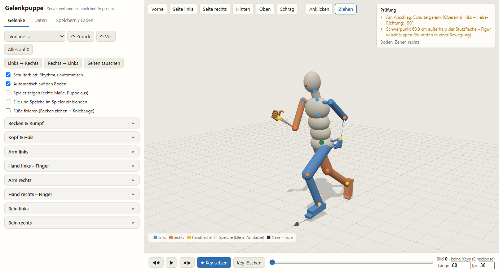

# Gelenkpuppe – Joint Puppet

**[Deutsche Anleitung → README.de.md](README.de.md)**

A browser-based posing and animation puppet built on human anatomy. Every joint has its real degrees of freedom and
range of motion, and the shoulder blade follows the arm automatically. A check panel flags poses that a human body
cannot do. Poses and motions are saved as JSON with joint angles plus derived data (joint positions, quaternions,
centre of mass, ground contact), ready to feed into Blender, Unity or any other engine.



> The user interface is in German. The labels are short, and the table under [Using the puppet](#using-the-puppet)
> translates the important ones. Translations are welcome as forks or pull requests.

## Features

- **Anatomical joints**: spine in three segments, neck, head, clavicle/shoulder blade, shoulder (plane of elevation,
  elevation, axial rotation), elbow plus radius/ulna rotation (pronation/supination), wrist, three phalanges per finger,
  thumb with opposition, hip, knee (rotation only when bent), ankle, toes. Limits come from normative range-of-motion
  tables.
- **Scapulohumeral rhythm**: above 30° of arm elevation the shoulder blade takes about a third of the movement.
- **Inverse kinematics**: drag a hand or foot with the mouse (mode "Ziehen"). The elbow and knee only bend the way
  they really can.
- **Automatic ground contact**: the body is dropped to the floor using the lowest point of the actual body surface.
  Optionally the feet stay pinned, so dragging the pelvis gives a squat.
- **Checks** (top right): joints at their limit, centre of mass outside the base of support, body parts in the
  floor, which body parts touch the ground.
- **Timeline with keyframes**: build motions, play them back, set frame count and fps.
- **Templates**: neutral, relaxed standing, T-pose, cheering, sprint, deep squat, hands on hips, and more.
- **Motion trainer** (`?training=3`): an evolution strategy optimises gait curves (walk, run, sprint, dribble) against
  measured reference curves. Cyclic motions (backpedal, side step, side shuffle) are solved from foot paths, so the
  stance foot stays still in the world. Sources: [docs/quellen-sources.md](docs/quellen-sources.md).
- **Optional own model**: a rigged character (`player.glb`) can follow the puppet with its real proportions.
- No build step and no installation: one HTML file, three.js from a CDN, and a small Python server that uses only
  the standard library.

## Quick start

Requirements: Python 3.8+ and a current browser (Chrome, Edge, Firefox).

```sh
git clone https://github.com/xitsam-tech/gelenkpuppe-joint-puppet.git
cd gelenkpuppe-joint-puppet
python puppe_server.py          # Windows: double-click "Puppe starten.bat", Linux/macOS: ./start.sh
```

The browser opens at <http://127.0.0.1:8765/>. Poses are saved to `posen/` next to the server. The server is bound to
127.0.0.1 only, so it cannot be reached from the network.

Options: `--port 8765`, `--posen <folder>`, `--no-browser`.

Without the server you can still pose: open `puppe.html` through any static web server. ES modules do not load from
`file://`. Use "Als Datei herunterladen" (download) instead of saving on the PC.

## Using the puppet

| German | Meaning |
|---|---|
| Anklicken / Ziehen | click a body part to open its sliders / drag hands and feet (IK) |
| Vorne, Seite links/rechts, Hinten, Oben, Schräg | camera: front, left/right side, back, top, oblique |
| Vorlage | template pose |
| Zurück / Vor | undo / redo (Ctrl+Z / Ctrl+Y) |
| Links → Rechts, Seiten tauschen | copy left side to right, mirror sides |
| Schulterblatt-Rhythmus automatisch | automatic scapulohumeral rhythm |
| Automatisch auf den Boden | automatic ground contact |
| Füße fixieren | pin feet (dragging the pelvis bends the knees) |
| Key setzen / Key löschen | set / delete keyframe |
| Länge, fps | length in frames, frames per second |
| Speichern / Laden | save / load (to `posen/`, as a download, or by pasting JSON) |
| Prüfung | checks |
| beug, spreiz, dreh, heben, ebene, kipp, gegen | flex, spread/abduct, rotate, raise, plane of elevation, tilt, opposition |

Colours: blue = left, orange = right, yellow = palm, black arrow = nose (forward).

## File format

Each pose or motion is one JSON file with `"format": "gelenkpuppe"`:

```jsonc
{
  "format": "gelenkpuppe", "version": 1, "name": "sprint", "beschreibung": "free text",
  "koerpergroesse_m": 1.8, "fps": 30, "laenge_bilder": 60,
  "konvention": { ... },            // axes and conventions, repeated in every file
  "gelenke": { ... },               // every joint and DOF with its range of motion
  "keys": [
    { "frame": 0,
      "winkel": { "LeftArm": { "ebene": 90, "heben": 40, "dreh": 0 }, ... },   // degrees per joint and DOF
      "abgeleitet": { ... } }        // derived: joint positions, quat_lokal, quat_rig, centre of mass, ground contact, hand directions, checks
  ]
}
```

- **Axes** are Blender's, in metres: +X = the figure's left, −Y = forward, +Z = up. Body height is 1.80 m. The pelvis
  rest height is 0.53 H.
- **Rest pose**: upright, arms hanging (carrying angle ~8°), palms towards the body, thumbs forward, feet under the hips.
- **`winkel`** is the source of truth. **`abgeleitet`** is recomputed on every save and is meant for importers.
  `quat_lokal` is `[w,x,y,z]` relative to the parent bone. `quat_rig` is the same without the automatic shoulder-blade
  share, for rigs that compute their own scapulohumeral rhythm.
- **Bone names** follow Mixamo: `Hips, Spine, Spine1, Spine2, Neck, Head`, and per side `Left/Right` + `Shoulder, Arm,
  ForeArm, ForeArmTwist, Hand, Thumb1-3, Index1-3, Middle1-3, Ring1-3, Pinky1-3, UpLeg, Leg, Foot, ToeBase`.

## Using your own character

1. You need a rigged model with the Mixamo bone names listed above. It must stand upright and face −Y, with +Z up,
   in metres.
2. Convert it with Blender (3.6+):
   ```sh
   blender -b -P make_player_glb.py -- path/to/character.fbx [mesh names to keep ...]
   ```
   This writes `player.glb` and `player_rest.json` next to `puppe.html`. The puppet then takes over the real joint
   positions and proportions. Tick "Eigenes Modell zeigen" to see the character instead of the mannequin.
3. Both files are in `.gitignore`. Your character stays private unless you remove those lines.

A forearm twist bone (`ForeArmTwist`) is optional but recommended, so the wrist does not candy-wrap on pronation.
Materials whose names start with `kit`, `trim` or `hair` are tinted in the puppet. `number…` and `name…` are hidden.

## Bringing poses into a game

The puppet only produces data. The import is up to you. Proven routes:

- **Blender**: read `keys[].abgeleitet.quat_lokal` (or `quat_rig`) per bone and keyframe the pose bones. Convert from
  the puppet's rest frame to your bones' rest orientation once, by comparing rest poses.
- **Unity / other engines**: per frame, compute the bone rotation relative to the bind pose (world rotation × inverse
  bind rotation), turn it into local rotations per parent, and write them as animation curves. The motion trainer
  saves cyclic motions as normal key sequences (`laenge_bilder`, `fps`), so you can sample them directly.
- Automate it with a headless browser. Load a file through `window.puppe.loadFile(json)`, step the keys, and read the
  skinned bones of your model (`window.puppe.player.bones`). Useful hooks on `window.puppe`: `applyPose`, `setPose`,
  `analyze`, `solveIK`, `buildFile`, `wpos`, `mpos`, `setView`.

## Forking and extending

- **Structure**: `puppe.html` holds the UI, skeleton, joint limits, IK, checks and file format. `training.js` is the
  motion trainer and is only loaded with `?training=...`. `puppe_server.py` serves the files and stores poses.
  `make_player_glb.py` converts your own model.
- **Proportions**: the mannequin uses shares of body height (Drillis & Contini / Winter) in the block
  `Ruhe-Skelett`. Change `H` for a different body height.
- **Joint limits**: the `TEMPL` table in `puppe.html`, with entries `d(key, label, min, max)`. Shoulder elevation is
  additionally coupled to the plane of elevation (`maxElev`).
- **New cyclic motions**: add an entry to `CYCLES` in `training.js` (speed, cycle time, duty factor, foot lift,
  lateral base, trunk lean, arm swing). Add it to `ES` and `NAMES`, open `?training=3` and save with
  `window.__trainingSave(true, ['<name>'])`. The foot paths are solved so that the stance foot does not slide. For a
  side step, keep `2 × base − stance travel ≥ 0.1 m`, so the feet never cross.
- **New gait targets**: `GAITS` in `training.js` (hip, knee and ankle curves over the gait cycle, from gait-analysis
  literature).
- Please keep the attribution and the licence, and mark your changes (see below).

## Licence

[Creative Commons Attribution-NonCommercial 4.0 International (CC BY-NC 4.0)](LICENSE).

- **You may** use, share, adapt and fork it for non-commercial purposes.
- **You must** credit "Gelenkpuppe / Joint Puppet by xitsam-tech", link this repository and the licence, and say what
  you changed.
- **Commercial use** needs separate permission. Open an issue to ask.
- Poses and animations you create with the puppet belong to you. The licence covers the puppet itself (code,
  documentation, reference data).

three.js (MIT) is loaded from jsDelivr and is not part of this repository.
